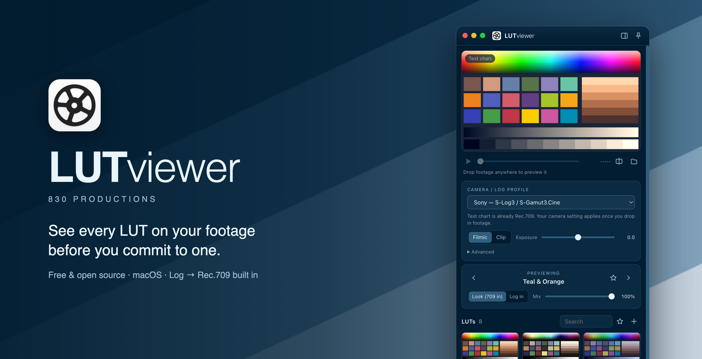
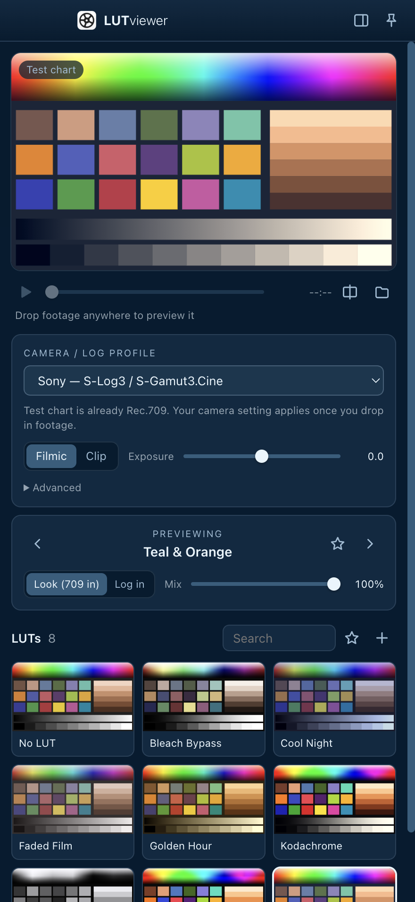

<p align="center">
  
</p>

<p align="center">
  <a href="https://github.com/830prod/LUTviewer/releases/latest/download/LUTviewer.dmg"></a>
</p>

<p align="center">
  <a href="https://github.com/830prod/LUTviewer/releases/latest"></a>
  
  
  <a href="LICENSE"></a>
  
</p>

---

**LUTviewer** is a free Mac app that answers one question fast: *which LUT should I use on this footage?*

It sits as a slim panel on the side of your screen. Drag your LUT collection in once, drop in a clip, and every LUT renders live on your actual frame. Pick the one you like, then go grade.

Shooting log? Tell LUTviewer your camera and it converts the footage to Rec.709 first, so creative LUTs look the way they were designed to.

## Download

1. **[Download LUTviewer.dmg](https://github.com/830prod/LUTviewer/releases/latest/download/LUTviewer.dmg)** (works on Apple Silicon and Intel Macs)
2. Open the DMG and drag **LUTviewer** into **Applications**.
3. **First launch only:** right-click LUTviewer in Applications → **Open** → **Open**.

> **Why the extra step?** LUTviewer is free and isn't notarized by Apple (that costs a yearly developer fee), so macOS asks you to confirm the first time.
>
> If macOS says the app **"is damaged and can't be opened"**, paste this into Terminal once, then open it normally:
> ```bash
> xattr -cr /Applications/LUTviewer.app
> ```

## Features



- 🎞 **Every LUT at once.** A live thumbnail grid shows each LUT in your library on the current frame, and it updates as you scrub.
- 📷 **Log → Rec.709 built in.** Pick your camera and LUTviewer handles the conversion. No conversion LUTs to hunt down.
- 🧭 **Side panel.** Docks to the edge of your screen and can float above Premiere, Resolve or Final Cut.
- 📂 **Drag & drop everything.** Drop in `.cube` / `.3dl` files or whole LUT-pack folders once and they're saved in your library. Drop footage on the window, the Dock icon, or use **Open With**.
- ↔️ **Before / after split.** Drag the wipe across the frame, or hold <kbd>\\</kbd> to see the image without the LUT.
- ⭐ **Favorites, search, mix.** Star your go-tos, filter by name or pack, and blend a LUT with the mix slider.
- 🎬 **ProRes friendly.** ProRes clips get a quick preview copy made automatically with macOS's built-in tools.
- 🔒 **Private and offline.** Nothing is uploaded. Your LUTs and footage stay on your Mac.

<br clear="right">

## Supported cameras

| Brand | Log profiles |
| --- | --- |
| **Sony** | S-Log3 / S-Gamut3.Cine · S-Log3 / S-Gamut3 · S-Log2 · HLG |
| **Canon** | Canon Log 3 · Canon Log 2 · Canon Log |
| **Panasonic / Lumix** | V-Log / V-Gamut |
| **Fujifilm** | F-Log2 · F-Log |
| **Nikon** | N-Log |
| **Blackmagic** | Film Gen 5 / Wide Gamut Gen 5 |
| **ARRI** | LogC3 / AWG3 · LogC4 / AWG4 |
| **RED** | Log3G10 / REDWideGamutRGB |
| **DJI** | D-Log / D-Gamut |
| **Apple** | Apple Log (iPhone 15 Pro and later) |
| **GoPro** | Protune Flat |
| **DaVinci** | DaVinci Intermediate / Wide Gamut |
| **Already graded** | Rec.709, no conversion |

Missing your camera? [Open an issue](https://github.com/830prod/LUTviewer/issues/new) and let us know.

## How to use it

1. **Add your LUTs.** Drag `.cube` / `.3dl` files or folders onto the window. You only do this once.
2. **Pick your camera** from the *Camera / log profile* menu.
3. **Drop in a clip** (or a still frame).
4. **Browse.** Click thumbnails or use the arrow keys, and compare with the split view.

### Looks vs. camera LUTs

There are two kinds of LUTs, and LUTviewer handles both:

| Type | What it expects | What LUTviewer does |
| --- | --- | --- |
| **Look** (creative LUTs, film emulations) | Rec.709 footage | Converts your log footage to Rec.709 first, then applies the look |
| **Log in** (e.g. `SLog3_to_Rec709.cube`) | Raw camera log | Applies the LUT straight to your log footage |

LUTviewer guesses the type from the file name (anything mentioning S-Log, C-Log, V-Log and so on is treated as *Log in*). Switch it any time with the **Look / Log in** toggle.

### Keyboard shortcuts

| Key | Action |
| --- | --- |
| <kbd>↑</kbd> <kbd>↓</kbd> / <kbd>←</kbd> <kbd>→</kbd> | Previous / next LUT |
| <kbd>Space</kbd> | Play / pause |
| <kbd>S</kbd> | Toggle before / after split |
| hold <kbd>\\</kbd> | Show without LUT |
| <kbd>F</kbd> | Favorite current LUT |
| <kbd>0</kbd> | No LUT |
| <kbd>⌘</kbd> <kbd>O</kbd> | Open footage |
| <kbd>⇧</kbd> <kbd>⌘</kbd> <kbd>L</kbd> | Add LUTs |
| <kbd>⇧</kbd> <kbd>⌘</kbd> <kbd>D</kbd> | Dock window to the right edge |

## Supported files

| | Formats |
| --- | --- |
| **LUTs** | `.cube` (3D and 1D), `.3dl` |
| **Video** | H.264, HEVC / H.265 (8- and 10-bit), ProRes (via automatic preview copy of the first 30 s) |
| **Stills** | JPG, PNG, TIFF, HEIC, WebP |

**BRAW, R3D and ARRIRAW** can't be opened directly. Export a short ProRes clip or a still from your editor first.

## FAQ

<details>
<summary><b>Is it really free?</b></summary>

Yes. LUTviewer is free and open source under the MIT license. No accounts, no subscriptions, no tracking.
</details>

<details>
<summary><b>Where are my LUTs stored?</b></summary>

LUTs you add are copied to `~/Library/Application Support/LUTviewer/LUTs`, so your library keeps working even if you move or delete the originals. Open it from **File → Show LUT Library in Finder**. Removing a LUT in the app moves its copy to the Trash.
</details>

<details>
<summary><b>How accurate is the log → Rec.709 conversion?</b></summary>

The conversion uses each manufacturer's published log curve and color gamut math, computed on the GPU in real time. **Filmic** adds a gentle highlight roll-off similar to the official camera LUTs; **Clip** is a straight technical conversion. It's built for choosing a look, not for final delivery. Do your final grade in your editor.
</details>

<details>
<summary><b>My footage looks washed out or too contrasty.</b></summary>

Check that the camera / log profile matches what you shot. If blacks still look lifted, open **Advanced** and toggle **Full data levels**. Some cameras and recorders write full-range files.
</details>

<details>
<summary><b>Does it work on Intel Macs?</b></summary>

Yes. The download is a universal app that runs natively on both Apple Silicon and Intel.
</details>

## Build from source

Requires [Node.js](https://nodejs.org) 20 or newer.

```bash
git clone https://github.com/830prod/LUTviewer.git
cd LUTviewer
npm install
npm start        # run the app
npm test         # check the color math
npm run dist     # build dist/LUTviewer.dmg
```

<details>
<summary>Project layout</summary>

```
src/main.js                   App windows, LUT library, footage loading
src/preload.js                Bridge between the interface and the app
src/renderer/colorscience.js  Camera log curves, gamut math, GPU shader
src/renderer/gl.js            WebGL2 renderer for the preview and thumbnails
src/renderer/lut.js           .cube / .3dl reader
src/renderer/app.js           Interface
src/renderer/splash.html      Splash screen
assets/                       830 Productions branding
build/                        App icon and DMG artwork
```
</details>

## Contributing

Bug reports, camera requests and pull requests are welcome. [Open an issue](https://github.com/830prod/LUTviewer/issues) to get started.

## License

[MIT](LICENSE) © 830 Productions

<p align="center"><sub>Made by <b>830 Productions</b></sub></p>
